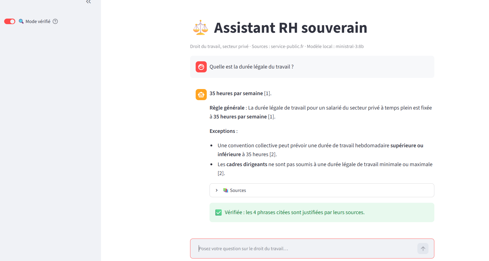
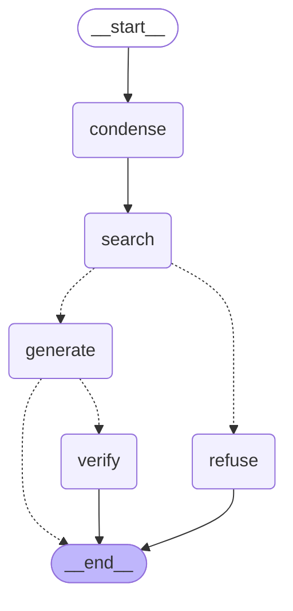
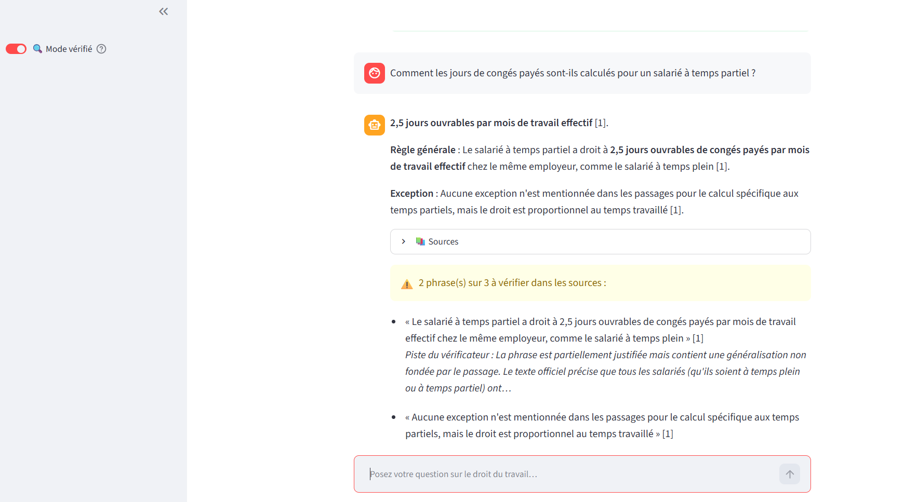

# Assistant RH souverain : RAG 100 % local sur le droit du travail français

Assistant qui répond aux questions des salariés et des services RH (congés payés, heures supplémentaires, télétravail, rupture conventionnelle…) à partir de **sources officielles**, en **citant ses sources**.

Tout tourne **en local** avec des modèles open source (Ollama) : aucune donnée ne quitte la machine, ce qui répond aux contraintes du **RGPD** et de la souveraineté des données.



*Réponse en mode vérifié : chaque phrase citée a été vérifiée contre sa source officielle.*

> 🚧 Projet en cours de construction. Ce README est complété à chaque étape.

---

## Fonctionnement (RAG : *Retrieval-Augmented Generation*)

```
 Sources officielles            INDEXATION (une fois)                    QUESTION (à chaque fois)
 (service-public.fr,      ┌──────────────────────────────┐        ┌───────────────────────────────┐
  Code du travail, PDF)──▶│ charger → découper en        │        │ question                      │
                          │ morceaux → embeddings (bge-m3)│        │   → embedding (bge-m3)        │
                          │ → base vectorielle Chroma ────┼──────▶ │   → recherche hybride :       │
                          └──────────────────────────────┘        │     vecteurs + BM25, fusion   │
                                                                  │   → reranking (cross-encoder) │
                                                                  │   → prompt + morceaux         │
                                                                  │   → Mistral (Ollama)          │
                                                                  │   → réponse + sources [1][2]  │
                                                                  └───────────────────────────────┘
```

## Stack technique

| Brique | Outil |
|---|---|
| LLM local | [Ollama](https://ollama.com) + **Ministral 3 8B** (Mistral AI) |
| Embeddings | **bge-m3** (multilingue, via Ollama) |
| Orchestration RAG | **LangChain** (briques, LCEL) et **LangGraph** (graphe de l'agent) |
| Base vectorielle | **ChromaDB** |
| Recherche | **Hybride** : vecteurs (sens) + **BM25** (mots exacts, `rank_bm25`), fusion par rang réciproque (RRF) |
| Reranking | **bge-reranker-v2-m3** (cross-encoder multilingue, `sentence-transformers`, chargé hors ligne) |
| Sources | Fiches officielles [service-public.fr](https://www.service-public.fr) (droit du travail, secteur privé) |

## Installation

Prérequis : Python 3.12, [Ollama](https://ollama.com/download), environ 8 Go de RAM libre, environ 4 Go de disque pour PyTorch et le reranker (téléchargé automatiquement au premier lancement).

```bash
# 1. Modèles locaux
ollama pull ministral-3:8b
ollama pull bge-m3

# 2. Environnement Python
python -m venv .venv
.venv\Scripts\activate          # Windows (Linux/macOS : source .venv/bin/activate)
pip install -r requirements.txt
```

## Utilisation

```bash
# 1. Construire l'index (une fois, environ 1 min 30 sur CPU)
python src/ingest.py

# 2a. Interface web de chat
streamlit run src/app.py            # http://localhost:8501

# 2b. API web (FastAPI) : documentation interactive sur http://localhost:8000/docs
uvicorn api:app --app-dir src --port 8000

# 2c. Ou en ligne de commande
python src/agent.py "Combien de jours de congés payés a un salarié ?"   # agent LangGraph
python src/agent.py --verifier "Comment sont majorées les heures supplémentaires ?"   # avec vérification
python src/agent.py --graph         # schéma du graphe (Mermaid)
python src/ask.py "Combien de jours de congés payés a un salarié ?"     # chaîne simple, sans aiguillage
python src/search.py "télétravail"  # recherche seule, sans LLM : vecteurs, BM25, hybride, hybride + reranking

# 3. Évaluation sur le jeu de test (data/eval/questions.json)
python src/evaluate.py              # recherche + refus hors sujet (≈ 6 min sur CPU)
python src/evaluate.py --reponses   # + exactitude et fidélité des réponses (≈ 30 min de plus)
```

## Structure du projet

```
├── data/
│   ├── sources.txt     # URL des pages officielles à indexer
│   ├── eval/           # jeu de test (questions.json) et résultats datés des évaluations
│   └── raw/            # PDF à indexer (optionnel)
├── src/
│   ├── config.py       # paramètres : modèles, taille des morceaux, nombre de résultats
│   ├── ingest.py       # chargement, nettoyage, découpage et indexation dans Chroma
│   ├── search.py       # recherche hybride (vecteurs + BM25, fusion RRF) puis reranking (sans LLM)
│   ├── agent.py        # agent LangGraph : reformuler → chercher → répondre ou refuser → vérifier
│   ├── verify.py       # vérification de chaque phrase citée contre sa source
│   ├── evaluate.py     # évaluation : rappel, MRR, refus, exactitude, fidélité
│   ├── app.py          # interface web de chat (Streamlit, streaming, sources notées)
│   ├── api.py          # API web (FastAPI) : POST /ask, GET /health
│   ├── ask.py          # briques : prompts, reformulation, recherche, chaîne de réponse
│   └── compare.py      # comparaison de modèles sur les mêmes questions
├── docs/               # captures d'écran du README
├── requirements.txt
└── README.md
```

## Choix du modèle

Comparaison sur les mêmes questions, avec la même recherche, le même prompt et `temperature=0` (`python src/compare.py`) :

| Question | Mistral 7B | Ministral 3 8B |
|---|---|---|
| Combien de jours de congés payés ? | Réponse exacte mais noyée dans des informations hors sujet | ✅ 30 jours ouvrables, 2,5 jours par mois, exceptions sourcées |
| Mon employeur peut-il m'imposer le télétravail ? | ❌ « Oui », règle inventée | ✅ « Non, sauf circonstances exceptionnelles ou force majeure » |
| Montant du SMIC ? (absent des sources) | ❌ Répond à d'autres questions | ✅ « Je ne trouve pas cette information dans mes sources. » |
| Temps de réponse (CPU) | 49 à 72 s | 22 à 46 s |

→ **Ministral 3 8B** est retenu.

## Recherche hybride

La recherche vectorielle compare le **sens global** : un détail précis de la question (« temps partiel ») peut s'y noyer. BM25 compte les **mots exacts**, mais ne reconnaît pas les synonymes (« patron » au lieu d'« employeur »). Les deux classements (10 candidats chacun) sont fusionnés par **Reciprocal Rank Fusion** : chaque morceau gagne `1 / (60 + rang)` dans chaque liste.

Rang du morceau qui contient la réponse (`python src/search.py "…"`) :

| Question | Vecteurs | BM25 | Hybride |
|---|---|---|---|
| Congés payés calculés pour un salarié **à temps partiel** ? | 7ᵉ ❌ | 3ᵉ | **2ᵉ** ✅ |
| Mon **patron** peut-il m'obliger à **télétravailler** ? | 2ᵉ | absent ❌ | 3ᵉ ✅ |
| Combien de jours de congés payés ? | 1ᵉʳ | 3ᵉ | 1ᵉʳ ✅ |
| Comment sont majorées les heures supplémentaires ? | 2ᵉ | 1ᵉʳ | 1ᵉʳ ✅ |

Seuls les 4 premiers morceaux sont envoyés au modèle. La question « temps partiel » passe ainsi de « Je ne trouve pas cette information » à « 2,5 jours ouvrables par mois de travail effectif [2] ».

## Reranking

Les 10 meilleurs candidats de la recherche hybride sont relus par un **cross-encoder**, qui lit la question et chaque morceau **ensemble** et leur donne une note de pertinence. Seuls les 4 mieux notés sont envoyés au LLM. Deux modèles multilingues comparés sur les 6 questions de contrôle :

| | mMiniLM (`cross-encoder/mmarco-mMiniLMv2-L12-H384-v1`) | **bge-reranker-v2-m3** |
|---|---|---|
| Temps par question (CPU, 10 candidats) | 1,2 s | 5,6 s |
| « temps partiel » (2ᵉ après hybride) | 2ᵉ | **1ᵉʳ** |
| « durée légale » (1ᵉʳ après hybride) | 2ᵉ (recule) | **1ᵉʳ** |
| « patron / télétravailler » : top 4 | 4 morceaux Télétravail | 4 morceaux Télétravail |

→ **bge-reranker-v2-m3** est retenu : il ne dégrade jamais le classement, pour environ 5 s de plus face à environ 35 s de génération. Le modèle est téléchargé une fois depuis Hugging Face (2,2 Go), puis chargé avec `local_files_only=True` : **aucune requête réseau** à l'utilisation.

## Agent LangGraph

Le traitement d'une question est un graphe (`python src/agent.py --graph`) :



- **condense** : reformule les questions de suite (« Et si je suis à temps partiel ? ») avec l'historique ; la décision de reformuler est prise par une règle dans le code.
- **search** : recherche hybride + reranking ; chaque morceau reçoit une note de pertinence de 0 à 1.
- **Aiguillage** : si la meilleure note est sous `RELEVANCE_THRESHOLD` (0,05), le graphe va vers **refuse** sans appeler le LLM. Mesuré sur 22 questions : hors sujet ≤ 0,02, dans les fiches ≥ 0,83.
- **generate** : le LLM rédige la réponse sourcée, diffusée mot par mot dans Streamlit (`stream_mode=["updates", "messages"]`).
- **verify** (interrupteur « 🔍 Mode vérifié ») : le code découpe la réponse en phrases citées, et le LLM vérifie chacune contre le passage qu'elle cite (sortie structurée Pydantic). Les phrases non justifiées sont signalées ⚠️.

### Vérification des réponses

| Méthode testée | Résultat |
|---|---|
| Le LLM relit toute la réponse avec les 4 passages | 3/5 verdicts justes : trop difficile pour un modèle 8B |
| Phrase par phrase, prompt **souple** | 8/9, mais laisse passer 1 des 2 vraies erreurs |
| Phrase par phrase, prompt **strict** (retenu) | 8/9, **détecte les 2 vraies erreurs** (dont « proportionnel au temps travaillé », absent des sources), 1 fausse alerte |

Coût : ≈ 16 s par phrase sur CPU, d'où une vérification **à la demande**. En droit, une fausse alerte (« à vérifier ») coûte moins cher qu'une erreur non détectée.



*Exemple réel : la phrase « le droit est proportionnel au temps travaillé » est absente de la source (qui dit l'inverse : 2,5 jours par mois, à temps plein comme à temps partiel) et elle est signalée. La première alerte (« comme le salarié à temps plein ») est une fausse alerte, conséquence assumée du prompt strict.*

## Évaluation

Jeu de test : **29 questions** (`data/eval/questions.json`) couvrant les 8 fiches, dont 5 hors sujet. Pour chaque question : le **passage exact** de la fiche qui contient la réponse et les **faits clés** attendus.

| Métrique | Équivalent RAGAS | Ce qu'elle mesure | LLM ? |
|---|---|---|---|
| **Rappel@4** | *context recall* | Le passage attendu est-il dans les 4 morceaux envoyés au LLM ? | Non |
| **MRR** | *context precision* | À quel rang ? (1ᵉʳ = 1, 2ᵉ = 0,5…) | Non |
| **Refus** | | Hors sujet refusé, et seulement le hors sujet | Non |
| **Exactitude** | *answer correctness* | Les faits clés attendus sont-ils dans la réponse ? | Non |
| **Fidélité** | *faithfulness* | Part des phrases citées justifiées par leur source (nœud `verify`) | Oui |

### Recherche : chaque étape du projet, mesurée

| Méthode | Rappel@4 | MRR |
|---|---|---|
| Vecteurs seuls | 88 % | 0,74 |
| BM25 seul | 96 % | 0,83 |
| Hybride (fusion RRF) | 96 % | 0,83 |
| **Hybride + reranking** | **100 %** | **0,98** |

### Réponses de l'agent (ministral-3:8b, CPU)

| Métrique | Résultat |
|---|---|
| Refus hors sujet | **29/29** |
| Exactitude (faits clés) | **100 %** |
| Fidélité | **83 %** (≈ 56 s par question, vérification comprise) |

La fidélité est une **estimation basse** : le vérificateur strict produit encore quelques fausses alertes. L'évaluation a d'abord servi à **corriger le vérificateur lui-même** : sur les mêmes réponses, la v1 donnait 65 % avec ≈ 18 fausses alertes ; la v2 (étiquettes « Règle générale : » retirées, question et titre de section transmis au vérificateur) donne 83 % et **détecte 2 vraies erreurs de plus** (une limite de 12 h étendue à tort, une condition « dans la limite de 1/10ᵉ » oubliée).

**Pourquoi pas la bibliothèque RAGAS ?** RAGAS 0.4.3 (et 0.3.9, 0.2.15) importe `langchain_community.chat_models.vertexai`, supprimé de `langchain-community` 0.4, et rétrograderait `rich` et `tenacity`. Plutôt que rétrograder toute la pile LangChain 1.x, les métriques principales sont réimplémentées ; celles de la recherche sont déterministes, sans LLM, donc rapides et reproductibles.

## API

Le même agent que l'interface Streamlit est exposé en **API REST** (FastAPI), pour être appelé par un autre logiciel (intranet RH, messagerie d'entreprise…). Documentation interactive générée automatiquement sur `/docs`.

| Route | Rôle |
|---|---|
| `GET /health` | État du service et modèles utilisés |
| `POST /ask` | Pose une question, renvoie la réponse sourcée |

Requête :
```json
{"question": "Et si je suis à temps partiel ?",
 "history": [{"role": "user", "content": "Combien de jours de congés payés a un salarié ?"},
             {"role": "assistant", "content": "30 jours ouvrables, soit 2,5 jours par mois [1]."}],
 "verify": false}
```

Réponse (extrait) :
```json
{"answer": "… 2,5 jours ouvrables par mois de travail effectif [1] …",
 "search_question": "Un salarié à temps partiel a-t-il le même nombre de jours de congés payés qu'un salarié à temps plein ?",
 "sources": [{"title": "Congés payés du salarié dans le secteur privé",
              "url": "https://www.service-public.fr/particuliers/vosdroits/F2258",
              "score": 0.992, "extract": "…"}],
 "checks": null}
```

- Formats d'entrée et de sortie décrits par des modèles **Pydantic** : une question de moins de 3 ou de plus de 500 caractères est refusée (erreur **422**) avant d'atteindre l'agent.
- `history` (4 derniers messages au plus) et `verify` sont facultatifs ; `checks` n'est rempli que si `verify` vaut `true`.

## Feuille de route

- [x] Installation : Ollama, modèles, environnement Python
- [x] Prise en main d'Ollama (LLM et embeddings)
- [x] Chargement, nettoyage et découpage des documents (136 morceaux, titre en tête de chaque morceau)
- [x] Embeddings et base vectorielle Chroma (recherche sémantique)
- [x] Chaîne RAG avec citations des sources
- [x] Amélioration du prompt et choix du modèle par comparaison
- [x] Interface Streamlit (chat, streaming, sources cliquables)
- [x] Questions de suite : reformulation avec l'historique de la conversation
- [x] Recherche hybride (BM25 + vecteurs, fusion RRF)
- [x] Reranking (cross-encoder bge-reranker-v2-m3, 100 % hors ligne)
- [x] Agent LangGraph : reformulation, recherche, refus hors sujet par seuil de pertinence
- [x] Mode vérifié : vérification de chaque phrase citée contre sa source (nœud LangGraph à la demande)
- [x] Évaluation sur un jeu de test de 29 questions (métriques de type RAGAS : rappel, MRR, exactitude, fidélité)
- [x] API FastAPI (`POST /ask`, `GET /health`, documentation `/docs`)
- [ ] Tests automatiques et CI GitHub Actions
- [ ] Docker

## Avertissement

Projet de démonstration : les réponses ne remplacent pas un conseil juridique. Toujours vérifier la source citée.
